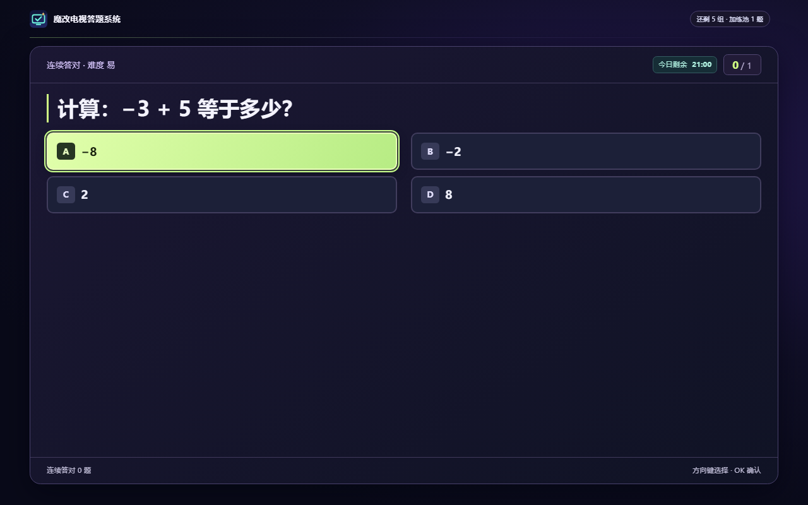

# TVQuiz · 魔改电视答题系统

**答题解锁看电视**

孩子用遥控器答题，完成一轮就能解锁一段看电视的时间。比如连续答对 **5 道题**，就能回到电视桌面看 **10 分钟**。看完这一轮，如果今天还有额度，就可以继续答题。家长用手机扫码设置规则，自己看电视时可以切换到家长模式。

**3,021 道内置题** · **幼儿园至九年级** · **Android TV，最低 Android 5.0（API 21）**

[下载正式 APK](https://github.com/nobcdz/TVQuiz/releases/latest) · [图文使用手册](docs/USER_GUIDE.md) · [让 Agent 帮你安装](#使用-agent-辅助安装) · [常见问题](docs/USER_GUIDE.md#常见问题)



## 主要功能

- **青少年模式**　答题获得观看时长。单轮余额用完后继续答题，全天额度用完后直接锁定并显示「每日一诗」。错题加练、每轮题数和奖励时长可由家长调整。
- **家长模式**　验证管理密码后进入电视系统桌面，观看期间免计时、免弹题。电视端密码输入使用遮挡显示。
- **一台电视，两个档案**　家长可以启用一个或两个孩子入口。每个孩子独立保存年级、观看余额和学习记录。
- **题库与批改**　内置语文、数学、英语练习，支持易、中、难、自定义题目、JSON 导入导出和主观题批改。
- **手机家长端**　与电视连到同一个局域网，扫码进入管理页，可调整规则、维护题库和查看使用记录。

## 安装与首次使用

| 你手边有什么 | 可以怎么装 |
| --- | --- |
| 一个 U 盘 | 下载 APK，拷到 U 盘，用电视的文件管理器打开。 |
| 电脑上的 Codex、WorkBuddy 或豆包工作 | 在电视上打开 ADB 调试，把电视 IP 填进下方提示词。 |
| 已装好 ADB 的电脑 | 按下方命令连接电视、安装并启动。 |

1. 从 [GitHub Releases](https://github.com/nobcdz/TVQuiz/releases) 下载电视版 APK，或按下文从源码构建。通过 U 盘或 ADB 安装。
2. 在电视上打开应用，设置家长管理密码，按引导开启观看守护所需权限。可开启无障碍服务，或按设备支持情况开启悬浮窗和使用情况访问。
3. 在开机页选择孩子档案或家长模式。青少年模式会按该档案的当前状态进入答题、锁屏或电视桌面。
4. 用手机扫开机页的家长管理二维码，输入管理密码登录。也可在电视上连续按五次遥控器 **↑** 打开家长验证入口。

第一次建议先在手机端选好孩子的年级，再回电视走一遍「选档案 → 答题 → 返回桌面」。确认时间用完后能重新弹出题目，再按家里的作息调整规则。 [首次设置与验收步骤](docs/USER_GUIDE.md#2-在电视上选择档案)

初始规则为连续答对 **5 道题**获得 **10 分钟**观看时长，每答错一次增加一道加练。默认每日上限为 **60 分钟、6 轮**，全天可用。家长可以按孩子分别修改这些设置。

家长管理页通过局域网 HTTP 提供，请在可信家庭网络内使用。

### 通过 ADB 安装下载的 APK

在电脑上安装 Android SDK Platform-Tools，在电视上启用 ADB 调试，并将两台设备连接到同一局域网。在 APK 所在目录运行以下命令，将 `<电视 IP>:<ADB 端口>` 和 APK 文件名替换为实际值。电视弹出授权提示时，确认允许调试。

```powershell
$device = '<电视 IP>:<ADB 端口>'
adb connect $device
adb -s $device install -r ".\TVQuiz-0.3.36.apk"
adb -s $device shell am start -n com.nobcdz.tvquiz/.MainActivity
```

### 使用 Agent 辅助安装

让电脑上的 Codex、WorkBuddy 或豆包工作帮你装。先让电脑和电视连上同一个 Wi-Fi，在电视设置里找到 IP 地址，并打开 ADB 调试。然后复制下面这段话，只改电视 IP。

找不到调试开关时，先看[各品牌电视怎么打开 ADB 调试](docs/USER_GUIDE.md#各品牌电视怎么打开-adb-调试)。

```text
请帮我把 TVQuiz 装到电视上。

电视 IP：<填这里，例如 192.168.1.20>

请从 https://github.com/nobcdz/TVQuiz/releases 下载最新正式版，用这台电脑连接电视、安装并打开应用。已有旧版就直接更新，保留原来的数据。如果需要我在电视上按确认，或者还需要查端口，请告诉我去哪里看。装完告诉我结果。
```

## 应用更新

从 v0.3.35 起，在电视上打开「家长管理 → 检查更新」，即可查看 GitHub 正式版本和更新说明。选择立即更新后，电视会下载 APK 并打开系统安装确认。普通更新可以按遥控器返回键稍后处理。

已安装 v0.3.34 正式版的用户需要先用 ADB 或 U 盘覆盖安装一次新版。使用相同正式签名覆盖安装会保留档案、设置和学习记录。

## 题库

内置 **3,021 道自编基础练习**，覆盖幼儿园和一至九年级。幼儿园题目包括数数、形状、颜色、动物、生活安全和英语启蒙。一至九年级包含数学计算与应用、英语词汇与语境、语文词语与阅读基础练习。自定义题填写年级即可参与该年级的出题。

| 数学 | 英语 | 语文 | 常识 |
| ---: | ---: | ---: | ---: |
| 1,993 | 582 | 436 | 10 |

以上为当前源码的题库数量，已发布 APK 的题量以对应版本为准。

### 不同年级会遇到什么题？

| 年级 | 学科 | 样题 | 答案 |
| --- | --- | --- | --- |
| 幼儿园 | 生活常识 | 哪种动物会喵喵叫？ | 猫 |
| 三年级 | 数学 | 长方形长 6 米、宽 4 米，面积是多少平方米？ | 24 平方米 |
| 五年级 | 语文 | 「镇定」的反义词是哪一个？ | 慌乱 |
| 八年级 | 英语 | 哪个英语单词可以表示「温度」？ | temperature |
| 九年级 | 数学 | 抛物线 y = (x + 3)² − 6 的对称轴是 x 等于多少？ | −3 |

在手机家长端打开 **题库管理 → 批量导入**，上传 JSON 文件或粘贴题目数组。例如：

```json
[
  {
    "subject": "数学",
    "level": "七年级",
    "type": "single",
    "difficulty": "易",
    "q": "−3 + 5 等于多少？",
    "a": ["−8", "−2", "2", "8"],
    "k": 2,
    "tip": "异号相加，用较大的绝对值减去较小的绝对值。"
  }
]
```

`k` 是从 0 开始的正确选项下标。难度可填写「易」「中」「难」，也支持数值 1–5。出题按档案匹配年级，并优先使用该档案尚未作答的题目。

## 从源码构建

使用 **JDK 17** 和 **Android SDK 34**。在仓库根目录运行：

```powershell
.\gradlew.bat :app:assembleTvDebug
```

Linux 或 macOS 使用 `bash ./gradlew :app:assembleTvDebug`。

调试 APK 位于 `app/native/app/build/outputs/apk/tv/debug/app-tv-debug.apk`。启用电视的 ADB 调试后，可通过以下命令安装：

```powershell
$device = '<电视 IP>:<ADB 端口>'
adb connect $device
adb -s $device install -r app/native/app/build/outputs/apk/tv/debug/app-tv-debug.apk
adb -s $device shell am start -n com.nobcdz.tvquiz/.MainActivity
```

| 目录 | 内容 |
| --- | --- |
| `app/native/app/` | Kotlin Android TV 应用与守护服务 |
| `app/web/` | 电视端本地 WebView 页面 |
| `admin/` | 手机家长管理页面 |
| `data/` | 内置题库 |
| `scripts/`、`tests/` | 本地构建、题库生成和回归验证 |

## 兼容性

目前有真机记录的设备是 **小米 MiTV4（Android 6.0.1）**。Android 5.0 是构建声明的最低版本。开机启动、后台保活、覆盖播放和电源键行为会随电视型号、固件及权限设置变化。

| 验证项目 | 小米 MiTV4 |
| --- | --- |
| 正式 APK 安装、启动 | v0.3.34、v0.3.35 和 v0.3.36 已通过 |
| v0.3.35 → v0.3.36 应用内升级 | 能发现新版和查看说明，下载失败 |
| v0.3.35 → v0.3.36 ADB 覆盖安装 | 成功，首次设置状态及孩子档案入口保留 |
| v0.3.36 观看模式页长按电源键 | 系统关机菜单正常显示 |

防卸载保护需要电视支持 Android 设备管理，并将本应用设为设备所有者。满足条件后，可在电视端 **家长管理 → 防卸载保护** 中启用或解除。

## 许可

Copyright © 2026 **nobcdz**。项目自有代码与素材采用个人非商业使用许可。使用与分发条件见 [LICENSE](LICENSE)，独立组件的许可见 [第三方许可声明](THIRD_PARTY_NOTICES.md)。
