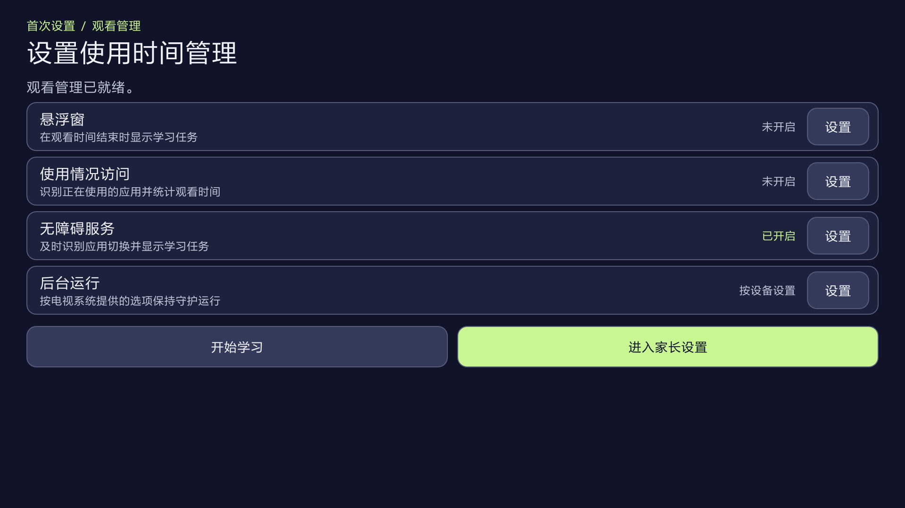
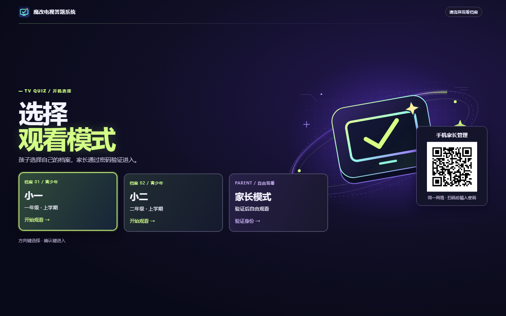
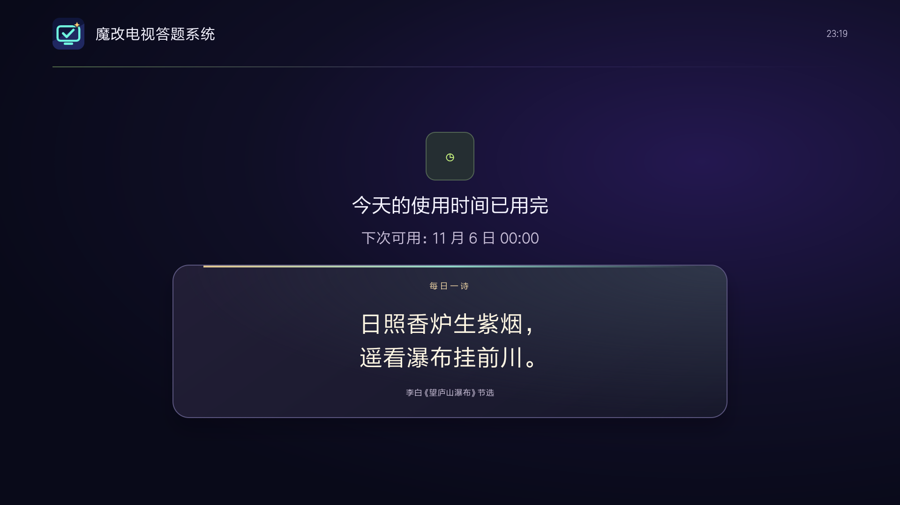
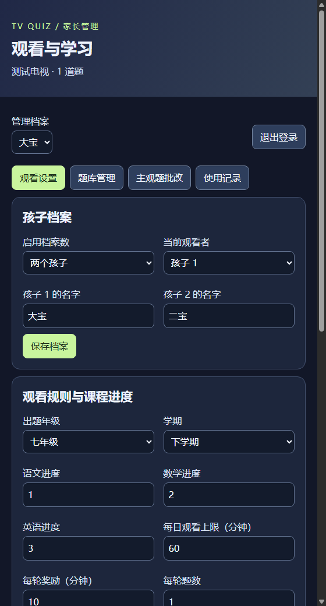

# 图文使用手册

本手册以 Android TV 上的「魔改电视答题系统」为例。界面示例使用演示档案和网络地址，请扫描自己电视上显示的二维码。

[返回项目首页](../README.md)

## 1. 安装并设置电视

1. 下载电视版 APK（如已发布），或按 [README 的构建说明](../README.md#从源码构建) 生成 APK。
2. 通过电视的文件管理器安装 U 盘中的 APK，或使用 ADB 安装。如果电脑上的 Codex、WorkBuddy 或豆包工作可以运行本机命令，可复制安装提示词，让 Agent 协助连接和安装。提示词只需要填写电视 IP。电视弹出授权或安装确认时，用遥控器确认。打开「魔改电视答题系统」，首次使用时设置家长管理密码。 [Agent 安装提示词](../README.md#使用-agent-辅助安装)
3. 在「设置使用时间管理」页按电视支持情况开启无障碍服务，或开启悬浮窗及使用情况访问。返回后可看到每项权限的状态。
4. 选择「进入家长设置」调整观看规则，或选择「开始学习」进入正常流程。

### 各品牌电视怎么打开 ADB 调试

先用遥控器打开电视的「设置」。同一品牌的不同型号，菜单名字也可能不一样。可以先在「网络」里点开当前连接，记下电视 IP。

| 品牌或系统 | 用遥控器怎么找 |
| --- | --- |
| 小米 / Redmi | 先试「设置 → 关于 → 产品型号」，连续按 7 次确定。再回到「设置 → 账号与安全」，把「ADB 调试」设为允许。此路径来自[小米电视和盒子官方说明](https://www.mi.com/tw/support/article/KA-17750/)，Redmi 以本机菜单为准。 |
| TCL / 雷鸟 | 如果电视显示 Google TV 或 Android TV，先试下面的通用方法。其他型号先在「设置 → 关于本机」记下完整型号，再按型号查找调试入口。[TCL 开发者平台](https://ap-developer.tclyun.com/)有电视调试和 ADB 连接说明。 |
| 海信 / Vidda | 先到「关于本机」看系统。Android TV 机型试下面的通用方法。若显示 VIDAA 系统，先确认这台电视能否安装 Android APK。 |
| 创维 / 酷开、长虹、康佳、海尔 | 如果是 Android TV，先试下面的通用方法。如果找不到「开发者选项」，把完整型号和系统版本发给 Agent，让它按型号查。 |
| 华为智慧屏 / 荣耀智慧屏 | 先确认具体型号能否安装 Android APK。华为部分型号支持通过分享或 U 盘安装第三方应用，可以先按官方方法尝试。[华为智慧屏安装说明](https://consumer.huawei.com/cn/support/content/zh-cn01089258/) |

**Android TV / Google TV 通用方法**

1. 打开「设置 → 系统」或「设备偏好设置 → 关于」，找到「Android TV 系统版本」或「版本号」，用遥控器连续按 7 次确定。
2. 返回上一层，进入「开发者选项」。有「无线调试」就打开；如果看到「ADB 调试」或「USB 调试」，也可以开启后让 Agent 试连，能否通过 Wi-Fi 连接取决于电视。
3. 回到 [Agent 安装提示词](../README.md#使用-agent-辅助安装)，填上电视 IP。电视弹出授权就用遥控器确认。如果 Agent 提示需要配对，再按它的提示查看电视显示的配对码和端口。 [Android 官方调试说明](https://developer.android.com/tools/adb?hl=zh-CN)

## 2. 在电视上选择档案

开机模式页会列出已启用的孩子档案和「家长模式」。用遥控器方向键移动，按 **OK** 确认。

- **孩子档案**　进入该档案的答题、锁屏或观看流程。
- **家长模式**　输入管理密码后返回电视原有桌面，家长观看期间免计时和弹题。
- **手机家长管理**　扫描电视上的二维码进入手机登录页，仍需输入管理密码。

## 3. 答题、观看和锁屏

用方向键选择选项并按 **OK**。遇到多选题时，选完后再按「确认所选答案」。题目上方的「今日剩余」显示该档案今天还有多少观看时间。

| 当前状态 | 电视行为 |
| --- | --- |
| 答题任务通过 | 获得本轮观看时长，回到电视原有桌面 |
| 答错且启用加练 | 按家长设置累计错题或增加加练 |
| 本轮观看时长用完，全天还有额度 | 显示下一轮答题任务 |
| 全天观看额度用完 | 直接锁屏，显示下次可用时间和「每日一诗」 |

## 4. 用手机管理档案和观看规则

1. 让手机与电视连接同一个局域网。在电视开机页扫码，输入管理密码。如果已离开开机页，可在电视上连按五次 **↑**，通过家长验证后打开连接页。
2. 手机端进入 **观看设置 → 孩子档案**，选择启用一个或两个档案，保存后可设置各自的名字。
3. 在页面顶部切换到要管理的档案。设置出题年级、每日观看上限和每轮观看时间，点「保存观看规则」。
4. 在 **题库管理** 中筛选、编辑、导入或导出题目。JSON 格式见 [题库示例](../README.md#题库)。主观题和近期观看记录分别在「主观题批改」和「使用记录」中查看。

## 常见问题

- **手机打不开管理页**　确认手机和电视在同一个局域网，并使用电视当前显示的二维码。管理页使用局域网 HTTP。
- **开机没出现模式页**　先手动打开应用完成初次设置，再核对电视固件的开机启动、无障碍或悬浮窗权限。
- **题目与孩子进度不符**　先确认顶部选中了正确档案，再检查出题年级。自定义题也需要填写年级。
- **额度用完后没有题目**　全天额度用完后进入锁屏页。单轮观看余额用完且全天仍有额度时，才进入下一轮答题。
