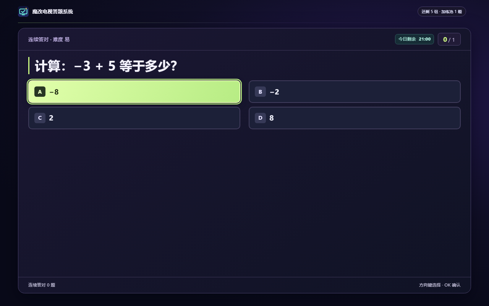
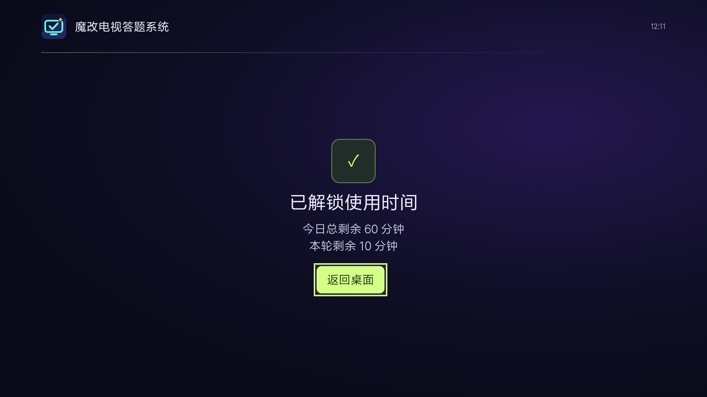
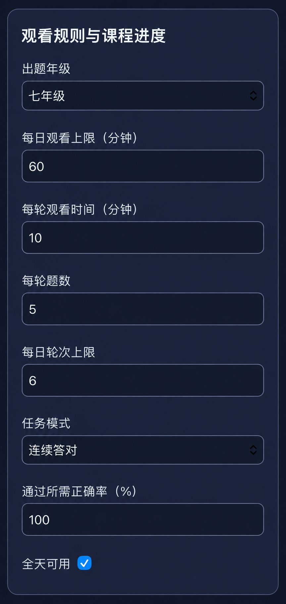

# TVQuiz 图文使用手册

**电视魔改答题系统 · 答题解锁看电视**

界面示例使用演示档案和网络地址，请扫描自己电视上显示的二维码。

[返回项目首页](../README.md)

[安装电视端](#1-安装并设置电视) · [试跑一轮](#首次设置后试跑一轮) · [用手机设规则](#4-用手机管理档案和观看规则) · [导入自定义题](#5-导入和检查自定义题) · [常见问题](#常见问题)

## 1. 安装并设置电视

1. 在 [GitHub 发布页](https://github.com/nobcdz/TVQuiz/releases/latest) 展开「Assets」，下载名称类似 `TVQuiz-0.3.35.apk` 的文件。自己构建可以参考 [README 的构建说明](../README.md#从源码构建)。
2. 通过电视的文件管理器安装 U 盘中的 APK，或使用 ADB 安装。如果电脑上的 Codex、WorkBuddy 或豆包工作可以运行本机命令，可复制安装提示词，让 Agent 协助连接和安装。提示词只需要填写电视 IP。电视弹出授权或安装确认时，用遥控器确认。打开「电视魔改答题系统」，首次使用时设置家长管理密码。 [Agent 安装提示词](../README.md#使用-agent-辅助安装)
3. 在「设置使用时间管理」页按电视支持情况开启无障碍服务，或开启悬浮窗及使用情况访问。返回后可看到每项权限的状态。
4. 选择「进入家长设置」调整观看规则，或选择「开始学习」进入正常流程。

如果选择 U 盘，把下载好的 APK 拷到 U 盘，插到电视上，再从电视的文件管理器打开。电视如果询问是否允许文件管理器安装应用，按屏幕提示确认。更新时也可以用这个方法，直接打开新 APK 覆盖安装。

### 各品牌电视怎么打开 ADB 调试

先用遥控器打开电视的「设置」。同一品牌的不同型号，菜单名字也可能不一样。可以先在「网络」里点开当前连接，记下电视 IP。

| 品牌或系统 | 用遥控器怎么找 |
| --- | --- |
| 小米 / Redmi | 先试「设置 → 关于 → 产品型号」，连续按 7 次确定。再回到「设置 → 账号与安全」，把「ADB 调试」设为允许。此路径来自[小米电视和盒子官方说明](https://www.mi.com/tw/support/article/KA-17750/)，Redmi 以本机菜单为准。 |
| TCL / 雷鸟 | 如果电视显示 Google TV 或 Android TV，先试下面的通用方法。其他型号先在「设置 → 关于本机」记下完整型号，再按型号查找调试入口。[TCL 开发者平台](https://ap-developer.tclyun.com/)有电视调试和 ADB 连接说明。 |
| 海信 / Vidda | 先到「关于本机」看系统。Android TV 机型试下面的通用方法。若显示 VIDAA 系统，先确认这台电视能否安装 Android APK。 |
| 创维 / 酷开、长虹、康佳、海尔 | 如果是 Android TV，先试下面的通用方法。如果找不到「开发者选项」，把完整型号和系统版本发给 Agent，让它按型号查。 |
| 华为智慧屏 / 荣耀智慧屏 | 先确认具体型号能否安装 Android APK。华为部分型号支持通过分享或 U 盘安装第三方应用，可以先按官方方法尝试。[华为智慧屏安装说明](https://consumer.huawei.com/cn/support/content/zh-cn01089258/) |

**Android TV / Google TV 通用方法**

1. 打开「设置 → 系统」或「设备偏好设置 → 关于」，找到「Android TV 系统版本」或「版本号」，用遥控器连续按 7 次确定。
2. 返回上一层，进入「开发者选项」。有「无线调试」就打开；如果看到「ADB 调试」或「USB 调试」，也可以开启后让 Agent 试连，能否通过 Wi-Fi 连接取决于电视。
3. 回到 [Agent 安装提示词](../README.md#使用-agent-辅助安装)，填上电视 IP。电视弹出授权就用遥控器确认。如果 Agent 提示需要配对，再按它的提示查看电视显示的配对码和端口。 [Android 官方调试说明](https://developer.android.com/tools/adb?hl=zh-CN)

## 2. 在电视上选择档案

开机模式页会列出已启用的孩子档案和「家长模式」。用遥控器方向键移动，按 **OK** 确认。

- **孩子档案**　进入该档案的答题、锁屏或观看流程。
- **家长模式**　输入管理密码后返回电视原有桌面，家长观看期间免计时和弹题。
- **手机家长管理**　扫描电视上的二维码进入手机登录页，仍需输入管理密码。

### 首次设置后试跑一轮

1. 用手机扫码登录，先给孩子选好年级，例如「幼儿园」或「三年级」，保存观看规则。
2. 回到电视选择孩子档案，确认题目旁显示的是刚选的年级。用遥控器答完一轮，然后选「返回桌面」。
3. 打开平时看的电视应用。到本轮时间结束时，确认电视能弹出下一轮题目。为了少等一会，可以先把「每轮观看时间」临时设为 **1 分钟**，试完再改回。
4. 回手机端打开「使用记录」，确认刚才的答题和观看时间出现在正确的孩子档案下。

## 3. 答题、观看和锁屏

用方向键选择选项并按 **OK**。遇到多选题时，选完后再按「确认所选答案」。题目上方的「今日剩余」显示该档案今天还有多少观看时间。

新版题目会在标题栏标出知识点。答错后页面停留在正确答案和解析，解析太长时可用遥控器上下键翻看。读完后按 **OK**，继续答题。

解锁后，电视会分别显示「今日总剩余」和「本轮剩余」。比如今天还有 60 分钟额度，这一轮可以先看 10 分钟。按「返回桌面」就能开始观看。

| 当前状态 | 电视行为 |
| --- | --- |
| 答题任务通过 | 获得本轮观看时长，回到电视原有桌面 |
| 答错且启用加练 | 按家长设置累计错题或增加加练 |
| 本轮观看时长用完，全天还有额度 | 显示下一轮答题任务 |
| 全天观看额度用完 | 直接锁屏，显示下次可用时间和「每日一诗」 |

## 4. 用手机管理档案和观看规则

1. 让手机与电视连接同一个局域网。在电视开机页扫码，输入管理密码。如果已离开开机页，可在电视上连按五次 **↑**，通过家长验证后打开连接页。
2. 手机端进入 **观看设置 → 孩子档案**，选择启用一个或两个档案，保存后可设置各自的名字。
3. 在页面顶部切换到要管理的档案。设置出题年级、每日观看上限和每轮观看时间，点「保存观看规则」。
4. 在 **题库管理** 中筛选、编辑、导入或导出题目。JSON 格式见 [题库示例](../README.md#题库)。主观题和近期观看记录分别在「主观题批改」和「使用记录」中查看。

在「观看设置」里往下滑，就能看到出题年级、每日观看上限、每轮观看时间和每轮题数。改完继续往下滑，点「保存观看规则」。

### 示例｜只在晚饭后看电视

在手机端打开「观看设置」，先选孩子档案，再按家里的作息填写。例如：

| 设置 | 示例值 |
| --- | --- |
| 出题年级 | 三年级 |
| 每轮题数 | 5 道 |
| 每轮观看时间 | 10 分钟 |
| 每日观看上限 / 每日轮次上限 | 30 分钟 / 3 轮 |
| 全天可用 | 关闭 |
| 开始时间 / 结束时间 | 18:30 / 20:00 |

点「保存观看规则」。这样每天只有在 **18:30 到 20:00** 可以看，最多 **30 分钟**。如果选「按组答题」并把「通过所需正确率」设为 **80%**，一组 5 道题至少答对 4 道才算通过。开启「全天可用」后，开始和结束时间会变灰。

## 5. 导入和检查自定义题

1. 在手机端打开「题库管理 → 批量导入」，粘贴 [README 的 JSON 示例](../README.md#题库)，或上传自己的 JSON 文件。
2. 把 `level` 改成孩子的年级，题干写在 `q`，选项写在 `a`。如果第 3 个选项正确，`k` 填 **2**。在 `topic` 写知识点，在 `tip` 写解题思路。
3. 导入后看「导入了多少道、跳过了多少道」。再用题库筛选选中对应学科和年级，点「查看题目」，确认题干、答案和解析正确。
4. 想保存一份自定义题，可先用筛选缩小范围，再点「导出筛选题库」。导出的文件用于导入题目。

## 6. 更新应用

从 v0.3.35 起，打开电视的「家长管理 → 检查更新」。看到新版本时，可以先看更新说明，再选择下载，最后用遥控器确认系统安装。

小米 MiTV4 实测能发现 v0.3.36，但应用内下载失败。遇到这个提示时，可以从 GitHub 下载正式 APK，再通过 ADB 或 U 盘覆盖安装。

如果目前装的是 v0.3.34 正式版，先从 GitHub 下载新 APK，用 U 盘或 ADB 覆盖安装一次。覆盖成功会保留档案、设置和学习记录。如果电视提示签名不一致，先停下来核对下载的 APK，卸载旧版会清除本地应用数据。 [GitHub 最新发布](https://github.com/nobcdz/TVQuiz/releases/latest)

## 常见问题

- **手机打不开管理页**　确认手机和电视在同一个局域网，并使用电视当前显示的二维码。管理页使用局域网 HTTP。
- **Agent 说电视离线或未授权**　在电视上重新打开调试设置，看看有没有授权弹窗。确认 Agent 用的是电视当前 IP；如果电视显示无线配对码，再按提示配对。
- **安装一直没结束**　看电视屏幕是否停在「安装确认」，用遥控器选择「确定」。
- **时间到了却没弹题**　先确认电视处于孩子档案下，并在「家长管理 → 权限设置」检查无障碍服务，或检查悬浮窗和使用情况访问是否都开启。
- **开机没出现模式页**　先手动打开应用完成初次设置，再核对电视固件的开机启动、无障碍或悬浮窗权限。
- **题目与孩子进度不符**　先确认顶部选中了正确档案，再检查出题年级。自定义题也需要填写年级。
- **额度用完后没有题目**　全天额度用完后进入锁屏页。单轮观看余额用完且全天仍有额度时，才进入下一轮答题。
